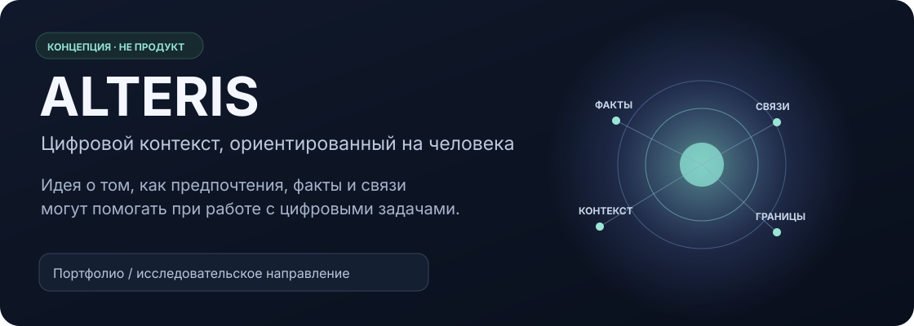
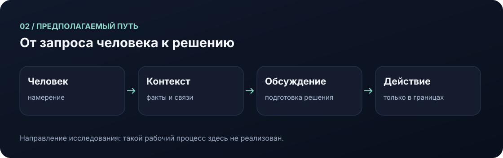
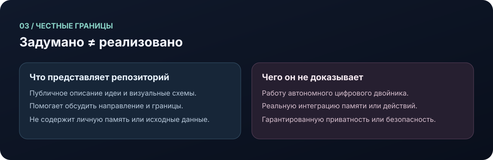

  

# ALTERIS

> **Статус: концепция.** В репозитории нет работающей системы, реализованной памяти или демонстрации. Ниже описана идея, а не доступные пользователю возможности.

**ALTERIS исследует идею личного цифрового контекста:** могли бы факты, связи, предпочтения и ограничения помогать человеку разбираться с повторяющимися цифровыми задачами?

Это направление из [портфолио Сергея Мартиросова](https://sergeymartirosov.ru/). Репозиторий содержит текст и авторские схемы для обсуждения идеи — не приложение или техническую реализацию.

## Идея в трёх шагах

1. **Учитывать контекст, а не только отдельный запрос.** В концепции важны сведения и отношения между ними, а также то, что важно самому человеку.
2. **Помогать подготовить решение.** Предполагаемый сценарий — использовать доступный контекст как опору для обсуждения, а не приписывать системе понимание человека.
3. **Оставлять контроль человеку.** Любые возможные действия должны обсуждаться в заданных человеком границах. Это принцип замысла, а не реализованная или проверенная политика.

## Из чего мог бы складываться контекст

Диаграмма показывает смысловые категории идеи. Она **не означает, что ALTERIS уже собирает, хранит или связывает такие сведения**.

## Возможные сценарии — только гипотезы

Ни один из примеров ниже не реализован и не проверен в работающей системе.

| Гипотетический сценарий | Что исследует идея | Статус |
| --- | --- | --- |
| Подготовиться к повторяющейся задаче с учётом ранее обозначенных предпочтений | Как предпочтения могли бы влиять на подготовку вариантов | Предполагаемый; функции нет |
| Увидеть связь между фактами из разных рабочих тем | Как связанный контекст мог бы помочь человеку сориентироваться | Предполагаемый; память и поиск не реализованы |
| Обсудить возможный следующий шаг до его выполнения | Как сохранять за человеком решение и контроль над действиями | Предполагаемый; автоматического выполнения здесь нет |

## Предполагаемый путь

Это эскиз направления, а не схема работающего процесса, архитектурная спецификация или обещание поведения системы. В частности, здесь не показана интеграция с какими-либо сервисами.

## Границы: что есть и чего нет

**В репозитории есть:**
- описание концепции;
- четыре оригинальные SVG-иллюстрации и скрипт, который их создаёт.

**В репозитории нет:**
- приложения, API, модели или подключённых сервисов;
- работающей памяти, личной базы данных или реальных пользовательских данных;
- демонстрации, тестов, бенчмарков или подтверждённых результатов;
- автономного цифрового двойника или автоматического выполнения задач.

**Не следует считать установленным:** точность воспроизведения предпочтений человека, приватность, безопасность, надёжность или соблюдение границ. Эти свойства не реализованы и не проверялись в рамках этой концепции. Иллюстрации — схемы, не скриншоты и не результаты работы.

## Файлы проекта

| Путь | Назначение |
| --- | --- |
| `README.md` | Описание идеи и её ограничений |
| `assets/01-alteris-hero.svg` | Фирменная заставка концепции |
| `assets/02-context.svg` | Категории предполагаемого контекста |
| `assets/03-flow.svg` | Гипотетическая последовательность шагов |
| `assets/04-boundaries.svg` | Наглядное разграничение идеи и реализации |
| `build_visuals.py` | Генератор этих четырёх иллюстраций; он не запускает ALTERIS |

## Лицензия

Авторский код и оригинальные материалы этого репозитория доступны на условиях [MIT License](LICENSE). Сторонние компоненты и товарные знаки остаются на условиях соответствующих правообладателей.
